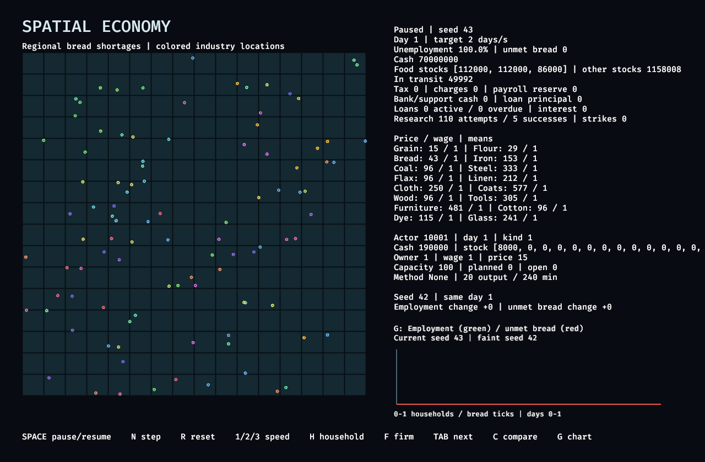
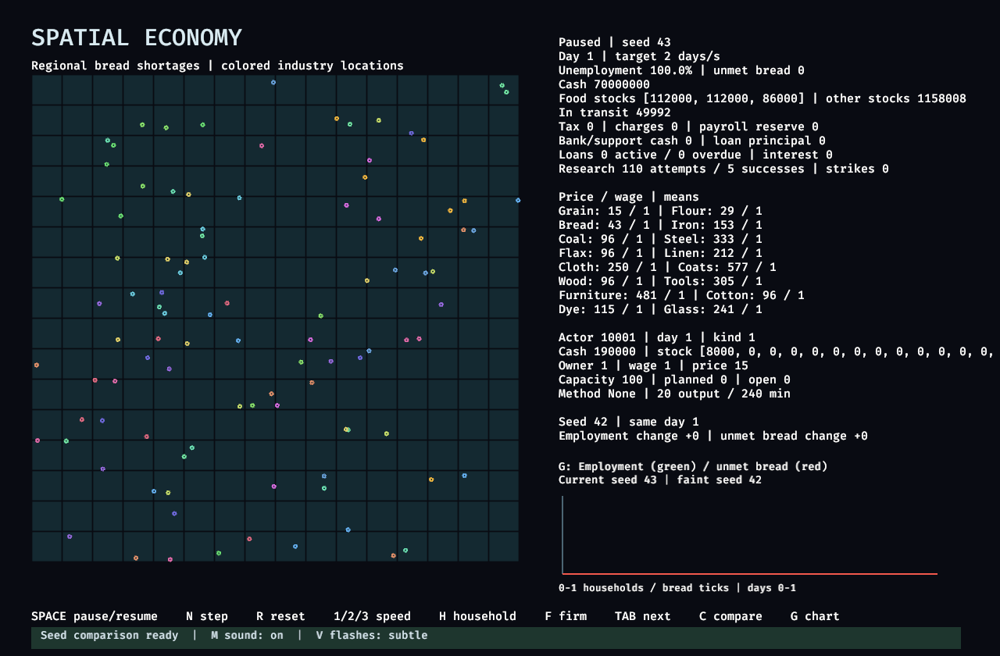
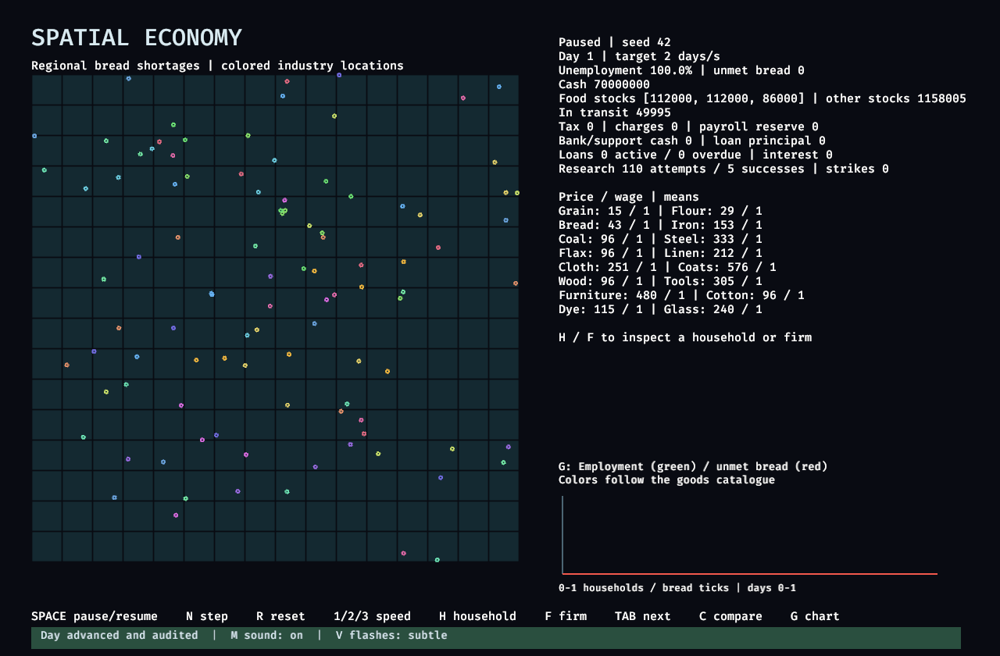

# Windows viewer evidence

The paused viewer previously rebuilt text, region colors, firm-marker lines, and charts on every frame. It now retains its geometry and refreshes presentation when the display revision or selected chart changes. Worker publications wake the window. Idle update intervals are 250 ms focused and 500 ms unfocused; banner pulses temporarily request 60 Hz updates.

The simulation kernels, ledger, phase ordering, audit cadence, and GPU readback contracts are unchanged. Worker publication, presentation, and feedback live in separate viewer modules. Completion cues are published after successful commands; ordinary automatic days produce no sound. M toggles sound, and V replaces the banner pulse with a static tint.

## Environment and baseline

- Windows 11 Pro 10.0.26200.
- Ryzen 9 9950X3D, 16 cores / 32 logical processors.
- RTX 3090, 24 GiB, NVIDIA driver 616.56, Vulkan.
- Rust 1.97.1, development profile: application optimization 1 and dependency optimization 2.
- Baseline runtime source: `e6eefb5836ff013c9f5ef81b0fdcb05e844de348`. The audited ICU development-profile overrides were needed to build that baseline locally. Windows security settings remained unchanged.

These are measurements of one Windows/Vulkan setup. Release builds, other graphics backends, and other operating systems were not measured.

## Paused viewer CPU usage

Both binaries opened the default chart with 100,000 households, paused at day zero. Each received a five-second warmup and three consecutive 20-second samples. There was no compilation or other test workload during the final samples. The viewer was selected for each run, with no control input during sampling. CPU time comes from the process's `TotalProcessorTime` counter.

| Measurement | Before | After |
| --- | ---: | ---: |
| Sample 1, CPU-seconds | 21.46875 | 0.203125 |
| Sample 2, CPU-seconds | 6.703125 | 0.187500 |
| Sample 3, CPU-seconds | 12.00000 | 0.156250 |
| Median CPU-seconds per 20 seconds | 12.00000 | 0.187500 |
| Approximate share of one CPU core at the median | 60.0% | 0.94% |

The median process CPU-time reduction is **98.4375%**. CPU-seconds sum work across threads, so a process can use more than 20 CPU-seconds during 20 wall-clock seconds. The baseline has substantial sample variation; all samples, actual wall times, memory counters, and binary SHA-256 hashes are retained in [before-profile.json](before-profile.json) and [after-profile.json](after-profile.json). This measures paused viewer CPU usage, rather than simulation throughput or GPU utilization.

## Headless GPU results

The before/after runs use the same scenarios, seed, GPU, and workgroup size. Final state hashes, scenario hashes, and GPU readback byte counts match at both tested population sizes, after both eight simulated days and forty simulated days.

| Households | Warmup days | Measured days | Before median day, ms | After median day, ms |
| --- | ---: | ---: | ---: | ---: |
| 1,000 | 20 | 20 | 31.925 | 35.356 |
| 10,000 | 20 | 20 | 57.607 | 52.472 |

Timing shifted in opposite directions at the two population sizes. The shorter two-warmup/six-day samples also contain large timing spikes and slower after totals. These measurements establish matching results and readback counts; they do not establish a headless throughput improvement. The performance claim for this change is the paused viewer CPU reduction above.

The complete, gzip-compressed reports include every day's phase timings, memory counters, hashes, snapshots, and full scenario payloads:

- [Before warmed run](before-warmed-headless.json.gz) and [after warmed run](after-warmed-headless.json.gz).
- [Before short run](before-headless.json.gz) and [after short run](after-headless.json.gz).
- [Machine-readable summary](summary.json).

## Validation and visual evidence

- [GPU test output](gpu-tests.txt): four passed, zero failed, including workgroup/experiment replay and memory-budget checks. No CPU backend tests were run.
- [Viewer verification output](viewer-check.txt): shared GPU device, completed reset/step/comparison cues, audited day, household/firm inspection, matching-day comparison, and captures of every chart.
- [Clippy output](clippy.txt): all targets with the viewer feature and `-D warnings`.
- [Build output](build.txt): `cargo build --locked --features viewer` passed.
- Dependency auditing found no vulnerability advisories in the enabled Windows viewer tree. The existing disabled ZIP/Zstandard advisories and active unmaintained `paste` warning remain; no new vulnerability advisory was introduced by the audio dependencies.

The captures below come from the GPU viewer. The PNG files preserve the rendered PPM pixels. The before/after overview shows the same comparison day and inspected firm; the step capture records the completion banner during its pulse.

| Before | After |
| --- | --- |
|  |  |



The generated mono WAV cues are embedded assets: [confirmation](../../../assets/cues/confirm.wav), [pause/reset](../../../assets/cues/pause.wav), and [error](../../../assets/cues/error.wav). Their durations and nonzero signal measurements are recorded in `summary.json`. The GPU viewer ran with its audio plugin enabled. Manual keyboard preference checks and human listening verification were not completed because Computer Use remained interrupted after an Escape stop.

## Reproduce

Build the proposed viewer and measure its paused CPU usage with no compilation or other GPU work in progress. Leave its window selected and do not press keys or move the pointer over it during sampling.

```powershell
cargo build --locked --features viewer
powershell -NoProfile -File scripts/measure-windows-viewer.ps1 -Output target/after-profile.json
```

Build the baseline in a separate checkout, with the same audited ICU overrides, then run the same measurement script against it:

```powershell
git worktree add ../bad-econ-before e6eefb5836ff013c9f5ef81b0fdcb05e844de348
cargo --config 'profile.dev.package.icu_normalizer_data.opt-level=0' --config 'profile.dev.package.icu_segmenter_data.opt-level=0' build --locked --features viewer --manifest-path ../bad-econ-before/Cargo.toml
powershell -NoProfile -File scripts/measure-windows-viewer.ps1 -Executable ../bad-econ-before/target/debug/bad_econ.exe -Output target/before-profile.json
```

Run correctness and warmed GPU measurements separately:

```powershell
cargo test --locked --features viewer --test gpu -- --test-threads=1
cargo clippy --locked --all-targets --features viewer -- -D warnings
cargo run --locked --features viewer -- view-check --households 10000
cargo run --locked --features viewer -- benchmark --sizes 1000,10000 --warmup 20 --days 20 --output target/warmed-headless.json
```
